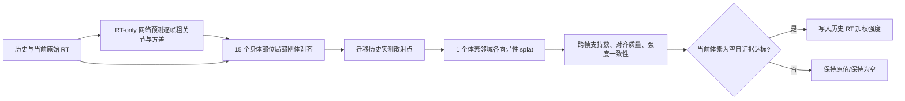

# 方案 B：预测几何引导的历史真实 RT 迁移

该模式在推理阶段只读取原始 RT。网络预测的 22 个粗关节负责建立历史帧到当前帧的身体部位对应关系；新增体素的强度全部来自历史帧实测 RT，不使用网络生成强度，也不读取 GT SMPL-X。

处理流程：



使用现有 `reliability_v2` 最佳检查点导出：

```bash
cd /data/M4Human-main
conda activate m4human
python -m rt_completion export \
  --checkpoint /path/to/best.pt \
  --export-config configs/rt_completion_scheme_b_export.yaml \
  --output /path/to/rt_completion_s1_scheme_b \
  --batch-size 1 \
  --workers 0
```

建议先只做小规模检查（该缓存会标记为不完整，不能直接用于正式训练）：

```bash
python -m rt_completion export \
  --checkpoint /path/to/best.pt \
  --export-config configs/rt_completion_scheme_b_export.yaml \
  --output /tmp/rt_completion_scheme_b_smoke \
  --splits val \
  --limit 8 \
  --batch-size 1
```

导出的 manifest 会明确记录：

- `completion_method: predicted_geometry`
- `intensity_source: historical_measured_rt`
- `uses_gt_at_inference: false`

每个稀疏新增记录还包含 `support_count`、`confidence`、`alignment_quality`、`intensity_disagreement_log`、`intensity_cv` 和 `joint_sigma_m`。`max_added_voxels` 只是安全上限，不会为了凑满数量而补体素。
