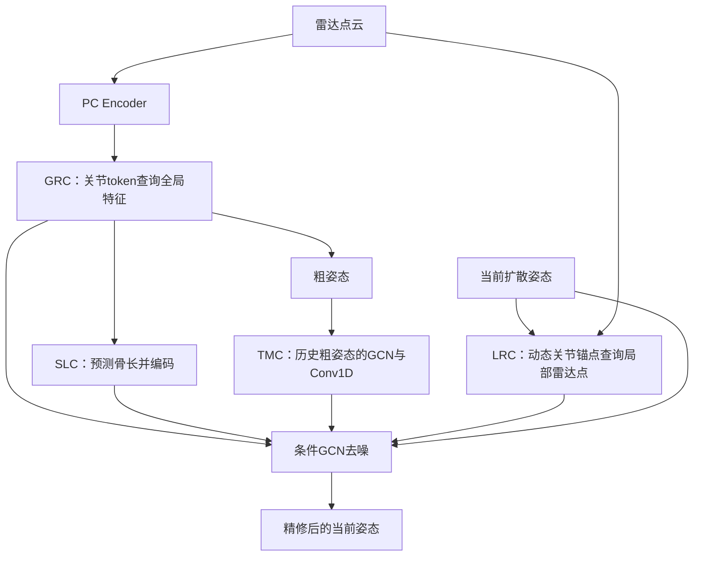
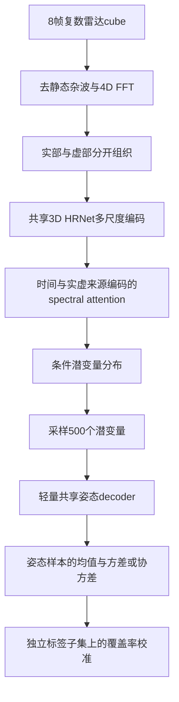
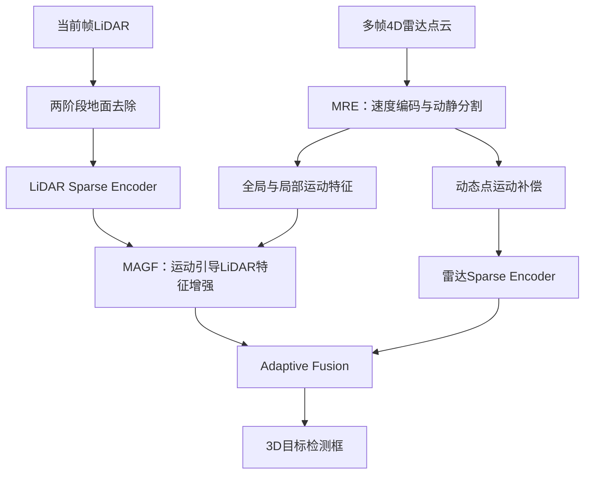

# 本地三篇论文精读：框架、理论与 RT 补全迁移

来源：`/data/M4Human-main/pdf` 中的三份 PDF。页码均指 PDF 实际页次；MoRAL 同时标明印刷页码。本文依据本地版本的方法、框架图、训练目标、关键实验及局限性整理。迁移建议是拟议设计，尚未实现或验证。

当前研究的三个改进：①部位运动 mask 与固定分组评测；②部位对齐、带可信度的时序伪 RT 目标；③局部可靠性融合与拒绝新增。

## 版本与任务核对

| 论文 | 本地版本依据 | 输入 | 输出 |
|---|---|---|---|
| mmDiff | 共18页；首页 arXiv:2403.16198v2，2024-07-22；不能按文件名写成2025版 | 雷达点云，每点 xyz、速度、能量、幅度 | 17个三维关节 |
| RadProPoser | 共8页；首页 arXiv:2508.03578v2，2026-05-20；本地首页仍有投稿声明 | 复数雷达 cube、多帧实部与虚部 | 26关节或HuPR的17关节预测分布 |
| MoRAL | 共7页；ITSC2025正式会议版，印刷2913–2919；DOI 10.1109/ITSC60802.2025.11423633 | 多帧4D雷达点云与当前LiDAR点云 | 三维检测框 |

三篇均不输出本项目的 XYZ 强度补全 RT，也没有直接给出完整 RT 强度 GT。可迁移的是条件组织、运动补偿、概率建模和校准机制。

## 1. mmDiff：人体结构和局部雷达条件如何组织

[本地 PDF](</data/M4Human-main/pdf/Fan 等 - 2025 - Diffusion Model Is a Good Pose Estimator from 3D RF-Vision.pdf>)。

### 框架：第4–9页，Fig.2在第5页

输入为 R_t∈R^(N×6)，每点包含 xyz、v、E、A；输出 H_t∈R^(17×3)。雷达编码器和全局关节特征提取器先给出粗姿态，再用条件GCN扩散模型精修。四种条件分别是全局雷达上下文GRC、局部上下文LRC、结构骨长一致性SLC、时序运动一致性TMC。

GRC学习17个关节token，与点云特征共同经过Transformer，让不同关节分别获取全局证据。LRC使用当前扩散步的关节位置作锚点，动态查询局部雷达点。SLC从关节特征预测16个骨长，并编码为条件；它是软条件与监督，不是保证严格骨长的FK层。TMC对历史粗姿态先用GCN编码，再沿时间做Conv1D以获取运动趋势。条件被投影到GCN姿态隐空间并注入各block。

### 理论与训练

扩散是在真实姿态上加入人工高斯噪声，再学习条件噪声预测 epsilon_theta(H_k,k,C)。人工姿态噪声不等于真实雷达热噪声、多径或旁瓣；该方法没有对这些干扰建立完整观测模型。

第8–9页采用两阶段训练：先用关节L2监督PC Encoder、GRC和粗姿态头；再冻结这些参数，训练其他条件模块与扩散GCN。第二阶段目标为噪声预测MSE加骨长L1。第9页设置为25步扩散、5个假设取平均、历史粗姿态8帧、局部KNN为50点。mm-Fi点数不足100时关闭LRC，说明局部证据稀缺确实会影响该模块。

### 对目前方案的契合

- 对①是间接支持：骨架和动态锚点可帮助构建随部位运动的mask，但原文没有运动mask恢复实验。
- 对②是部分支持：SLC/TMC可稳定部位位置并提供运动线索，但没有历史回波warp或可信强度伪GT。
- 对③中的局部查询很相关：可将joint token改为22个，或使用15个part token查询3D CNN特征；可靠度与弃权仍需新增。

迁移LRC时不宜始终强取固定数量的最近点：某部位完全无回波时，最近点也可能属于其他部位。应加入最大查询距离、有效观测数量和无证据选项。对于稠密网格特征，固定坐标查询合法，但必须区分该处只有上下文特征还是确有实测支持。

第10–11页报告mmBody基线P4Transformer MPJPE 78.10mm、完整mmDiff 68.08mm。该论文第10页明确MPJPE经过pelvis对齐，不能直接与本项目包含平移的绝对坐标MPJPE比较。原文第13页的运动速度统计也不能单独证明运动准确，过度平滑同样会降低速度。

## 2. RadProPoser：预测分布与不确定性校准

[本地 PDF](</data/M4Human-main/pdf/Mueller 等 - 2025 - RadProPoser Probabilistic Radar Tensor Human Pose Estimation That Knows Its Limits.pdf>)。

### 框架：第3–5页，Fig.3在第4页

单雷达默认8帧，实部/虚部共形成16个stream的编码向量。attention的token代表帧与信号分量，不是身体部位或单个体素。多雷达时再沿该维度堆叠。共享编码器是确定性的；随机性来自条件潜变量分布，500个样本只需并行通过轻量decoder，并不是重复运行500次雷达编码器。

### 理论与训练

Gaussian潜变量通过重参数化采样，并用KL向标准正态正则；Laplace潜变量采用逆CDF采样，原文明确不使用该KL正则。decoder将各潜变量样本转为完整姿态，随后计算输出统计量。

第5页比较对角Gaussian、全协方差Gaussian和独立Laplace输出似然。全协方差Gaussian目标包含误差的Mahalanobis项和log-determinant项：前者按预测不确定性衡量残差，后者约束通过无限增大方差降低误差惩罚的行为。输出协方差对应姿态坐标之间的相关性，不是体素空间协方差。

编码器没有建模网络权重后验，潜变量采样也不自动构成可识别的认知不确定性分解。原文主要将所建模的方差解释为异方差偶然不确定性；后处理的覆盖校准反映实际预测残差，不能证明它已分别识别传感器、模型和标签误差。

### 校准细节与结果

第5页使用isotonic regression拟合预测CDF与经验覆盖率的单调映射，同时报告ECE和sharpness。第7页Table VIII中，全协方差Gaussian的ECE为0.140→0.027，sharpness由6.290增至40.884cm²。校准改善覆盖率，但区间显著变宽，不能只报告ECE而忽略信息量。

第2–3页明确：自采数据初始8人训练、p3调参、p1/p2/p12测试；最终用9个non-test人训练；校准在原测试人员p1拟合，在p2/p12评估。因此校准后的独立评估并非仍涵盖全部三位原测试人员。迁移到本项目应明确独立校准与最终测试划分。

### 对目前方案的契合

- 对①没有直接mask方法；可启发按遮挡严重度报告校准和恢复风险。
- 对②可提供关键补充：从关节点估计扩展到关节分布，进而传播部位对齐不确定性。
- 对③最相关的是概率与覆盖校准；原文没有拒绝新增，也没有逐体素历史可靠性模型。attention分数不能直接当作可靠概率。

本项目只有实值XYZ强度，没有ADC、Doppler或复相位，无法复现其FFT/实虚spectral分支。可先迁移关节分布和校准机制，不必先实现500样本潜变量模型；姿态全协方差也不宜直接扩展为416,361体素的完整协方差矩阵。

一个拟议迁移是：采样多组关节→构造多组部位warp→对同一历史RT生成多份对齐结果→以结果分歧衡量几何对齐敏感性。该分歧仍需与实测留出恢复误差验证；校准人工缺失不等于已校准所有天然未知位置。

## 3. MoRAL：先补偿运动，再利用多帧信息

[本地 PDF](</data/M4Human-main/pdf/Peng 等 - 2025 - MoRAL Motion-Aware Multi-Frame 4D Radar and LiDAR Fusion for Robust 3D Object Detection.pdf>)。

### 框架：第2–4页，Fig.2/4在第3页

雷达每点有七项属性：xyz、RCS、相对径向速度、绝对径向速度、时间戳。MRE将速度属性增强后，经过逐点attention和SA/FP层，预测moving/static；动静监督来自VoD目标运动标注。原文没有给出独立的噪声置信度或不确定性训练目标。

### 运动补偿理论

第3–4页式(1)–(3)沿径向建立速度向量，再按时间差外推动点，可概括为p_aligned=p_source+Delta_t×v_radial_vector；静态点保持不动。它减少直接多帧叠加形成的拖尾。

原文把式(3)中的tau称sampling frequency，但按量纲实现时应明确Delta_t的秒单位。更关键的是，第6页讨论明确承认径向速度不是完整三维速度：切向运动径向分量接近零时补偿不足，背景动静误判还会引入新噪声。

### MAGF门控的真实含义

第4页式(4)–(7)先做LiDAR通道重标定，再融合雷达SA/FP运动特征，得到门控G，最后：

    F_L_enhanced = F_L_prime × G + F_L_prime = (1+G) × F_L_prime

其中G由Sigmoid给出。因此这一门控是残差增强，不是已经校准的噪声概率，也不是把所有不可信历史关闭的弃权机制。它增强的对象首先是LiDAR特征，而不是当前雷达体素；没有逐历史帧的可靠性softmax或null token。

第5页Table II的All Area mAP：基线72.22，仅MRE73.08，仅MAGF73.01，两者73.30。MAGF与MRE的运动特征提取器存在功能耦合，不能把消融理解为完全独立模块的简单相加。

### 对目前方案的契合

- 对①是评测启发：增加快速摆臂、横向运动等容易错位的mask和动作子集；原文没有人体mask恢复。
- 对②最直接：借鉴对齐后再累积。但当前RT没有径向速度，必须改用逐帧预测关节、部位变换或学习残差位移；原文也没有可信伪RT强度GT。
- 对③只提供运动引导门控和全局/局部特征互补的参考；动静分类、噪声可信度、最终新增风险是三个不同概念。

不应将静止人体回波当噪声，也不应因为某回波持续存在就判定其为真实身体回波。部位几何对齐只建立空间对应，不保证视角变化后的回波强度相等。

## 4. 三篇与当前三个改进的对应

| 原文 | ①运动mask与固定评测 | ②部位对齐与可信伪GT | ③可靠融合与弃权 |
|---|---|---|---|
| mmDiff | 间接：动态锚点与骨长帮助定位部位 | 间接：稳定骨架、运动趋势；没有回波warp | 局部/全局查询相关；没有校准可靠度或弃权 |
| RadProPoser | 没有mask设计；可增加风险评测 | 关节分布可传播为对齐不确定性；需新设计 | 概率建模与覆盖校准相关；没有拒绝新增 |
| MoRAL | 没有mask设计；运动方向局限可指导分组 | 运动补偿动机最直接；输入与运动模型要替换 | 门控和多尺度运动特征相关；不是噪声置信或弃权 |

## 5. 建议组合与验证边界

可以保留现有3D CNN、ConvGRU与RT解码器，逐步加入：关节/部位token查询和骨长约束（mmDiff启发）→关节分布及独立校准（RadProPoser启发）→预测部位运动对齐历史特征（MoRAL启发）→局部证据可靠性与无证据选项→RT强度解码和风险筛选。

人工运动mask、固定分组评测、带置信度的伪RT目标和拒绝新增仍是本项目需要提出并验证的机制，不能归为三篇原论文已经完成的功能。训练使用SMPL-X标签；推理变换和几何必须来自RT预测。三篇都没有解决当前无完整RT强度GT的问题。

建议依次消融：关节/部位查询；骨长约束；根平移对比部位对齐；对齐不确定性；可靠性融合与弃权。保持训练监督、原始时间范围和新增体素预算一致，报告留出回波误差、风险—覆盖率、快速动作子集和独立下游MPJPE/MVE。不同论文数据集、关节数量与误差对齐协议不同，不将其公开指标与本项目当前结果直接排名。
